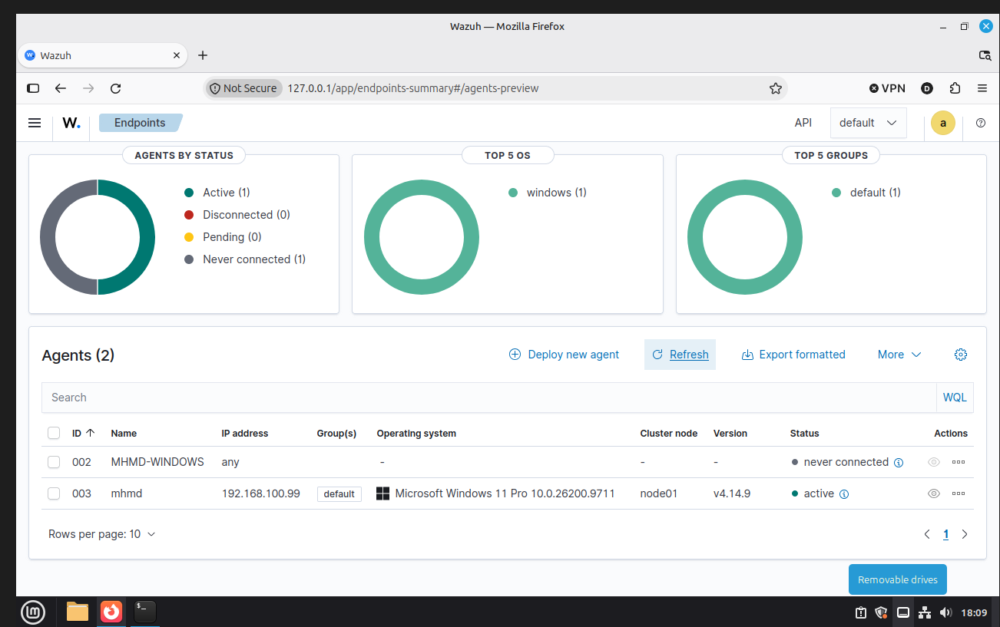
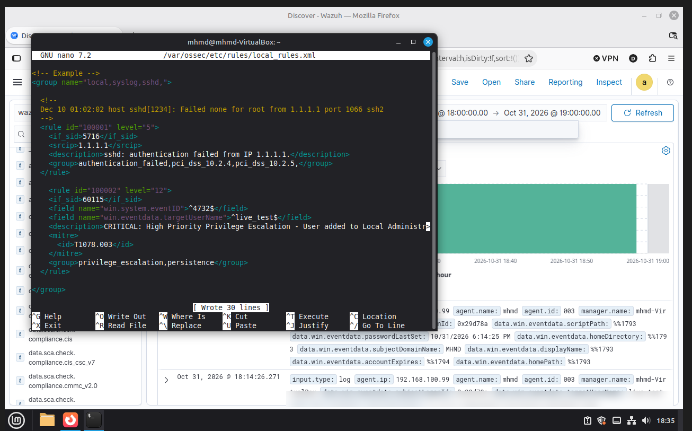
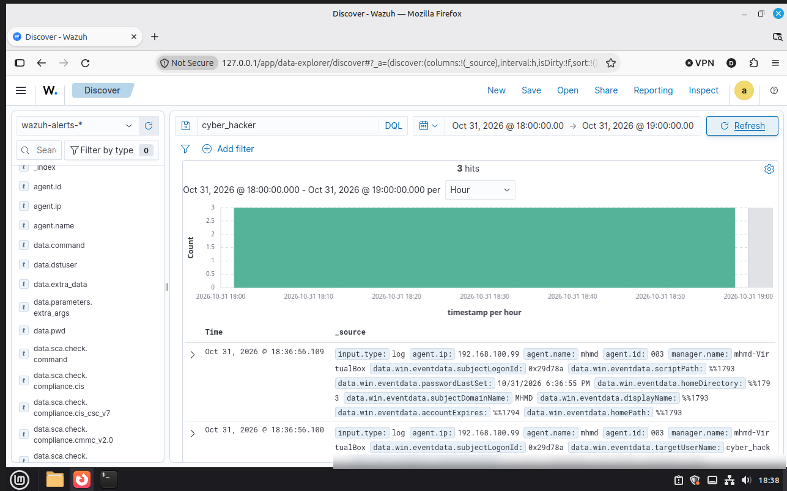
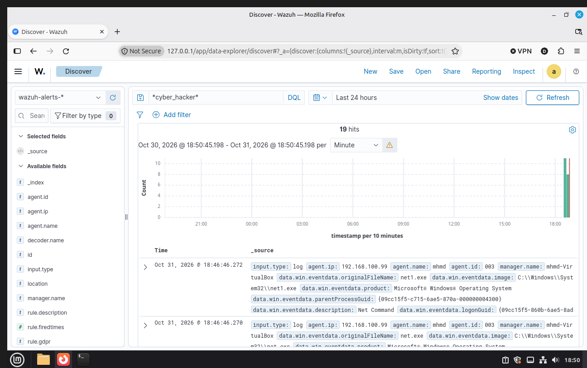

# Project 13: Single-Node Home SIEM Lab (Wazuh + Sysmon)

A small, self-built SIEM lab. A Wazuh manager running in a Linux Mint VM collects Windows Security and Sysmon logs from my own Windows 11 PC. I wrote one custom detection rule, triggered it myself in a controlled test, and documented what worked, what broke, and what the rule does not cover.

> **Scope:** one manager, one single-node indexer, one monitored Windows agent, all on my home network. This is a learning lab, not an enterprise deployment.
> **AI assistance:** I used AI guidance while building and troubleshooting this lab. I ran every step myself and can explain it, but I did not write everything unaided.

---

## Architecture

| Component | Detail |
|---|---|
| SIEM | Wazuh manager + indexer + dashboard v4.14.9, single node |
| Manager host | Linux Mint VM (VirtualBox), `192.168.100.55` |
| Monitored endpoint | Windows 11 Pro physical PC, `192.168.100.99` (agent ID 003) |
| Endpoint telemetry | Windows Security log + Sysmon (`Microsoft-Windows-Sysmon/Operational`) via `eventchannel` |
| Sysmon setup | Installed with `-i -n -accepteula`, default configuration (no custom config file) |
| Firewall (manager) | UFW allowing TCP 1514 (agent data) and TCP 1515 (enrollment) |

```
Windows 11 PC (agent 003)  --1515 enroll / 1514 events-->  Wazuh manager (Linux Mint VM)
  Security log + Sysmon                                      +- indexer -> dashboard (Discover)
```

---

## What I built

1. Deployed the Wazuh stack on the Linux Mint VM and opened only the ports the agent needs.
2. Enrolled the Windows PC as an agent and confirmed it shows **Active**.
3. Installed Sysmon on Windows and added the Sysmon event channel to the agent's `ossec.conf`.
4. Wrote custom rule **100002** in `/var/ossec/etc/rules/local_rules.xml`.
5. Ran a controlled test in my own lab and confirmed the rule fired.


*Agent 003 (Windows 11 Pro, 192.168.100.99, v4.14.9) is active. Agent 002 is a leftover from a failed first enrollment and never connected.*

---

## The detection: rule 100002

**Goal:** alert when a user is added to the local Administrators group (Windows Event ID 4732).

**Logic:** child of built-in rule `60115`. It matches the Event ID and the group name. In a 4732 event, `win.eventdata.targetUserName` holds the **group** name and the added account is in `memberId`, so the rule needs no hardcoded usernames.

- **Level:** 12
- **MITRE ATT&CK:** T1098 Account Manipulation (persistence)

### Version 1 (replaced)

My first draft matched a hardcoded test account name, so it could only ever detect my own test.


*Version 1 in nano. The `live_test` match is the mistake I fixed.*

### Version 2 (current)

```xml
<rule id="100002" level="12">
  <if_sid>60115</if_sid>
  <field name="win.system.eventID">^4732$</field>
  <field name="win.eventdata.targetUserName">^Administrators$</field>
  <description>User added to local Administrators group (Event 4732)</description>
  <mitre>
    <id>T1098</id>
  </mitre>
  <group>privilege_escalation,persistence</group>
</rule>
```

In my test, adding a test user to the local Administrators group made this rule fire at level 12 in Discover (`rule.id: 100002`).

---

## Telemetry I could see

I created a test account and added it to the Administrators group with `net user` and `net localgroup`, then looked for it in Discover.

**Windows Security log events** for the account arrived from the agent:


*Raw Security events for the test account (3 hits), including the agent IP and the parsed event fields.*

**Sysmon process events** showed what the endpoint actually ran (`net.exe` spawning `net1.exe`):


*19 hits for a free-text search on the test account name. These are raw log events, not alerts from my rule.*

---

## Problems I hit and how I fixed them

- **Windows installer froze.** My download path pointed at a OneDrive-redirected Desktop. Fix: download to the Downloads folder and run the installer with the passive UI switch (`/qb`).
- **Duplicate agent name on enrollment.** An earlier registration attempt had left an entry behind. Fix: re-enrolled with `agent-auth.exe` using the `-A` flag to set the name explicitly.
- **Events seemed missing in Discover.** The events were never lost. The dashboard's absolute time window was hiding them until I changed the window. Lesson: check the time filter before assuming the pipeline is broken.
- **Rule written against the wrong field.** My first draft treated `targetUserName` as the user. In event 4732 it is the group. I found this by opening the raw event in Discover and comparing field values.

---

## Limitations and next steps

- **An alert means "look at this", not "attack".** Adding someone to Administrators is also a normal admin action. The rule cannot tell authorized from unauthorized.
- **No negative testing yet.** I have shown the rule fires when it should. Next I want to confirm it stays quiet when a user is added to a non-admin group, or when a user is created with no group change.
- **Only the local Administrators group.** Domain groups (events 4728, 4756) and other privileged groups are not covered.
- **English group name.** The rule matches the name "Administrators". On a non-English Windows install the name differs; the well-known SID (`S-1-5-32-544`) would be more robust.
- **Tested one method.** I used `net localgroup`. PowerShell and the GUI should create the same event, but I have not tested them.
- **Depends on Windows auditing.** If Security Group Management auditing is off, the event never exists.
- **Default Sysmon config.** A tuned community config would give richer telemetry.
- **No baseline of normal activity.** One PC, one user, so no false-positive tuning.
- **Not a full attack simulation.** The test ran as an administrator, so it models persistence after access, not initial compromise.

---

## What I learned

- How a SIEM pipeline fits together: agent, manager, decoder, rule, indexer, dashboard.
- Reading raw event fields instead of trusting the first label I see.
- Writing a detection that matches an event's structure rather than my own test data.
- Writing down limits honestly, the same way I did in my earlier projects.

---

## Safety notes

- Everything ran on my own hardware.
- Test admin accounts were removed after the test.
- No passwords or private identifiers are published in this repo.
